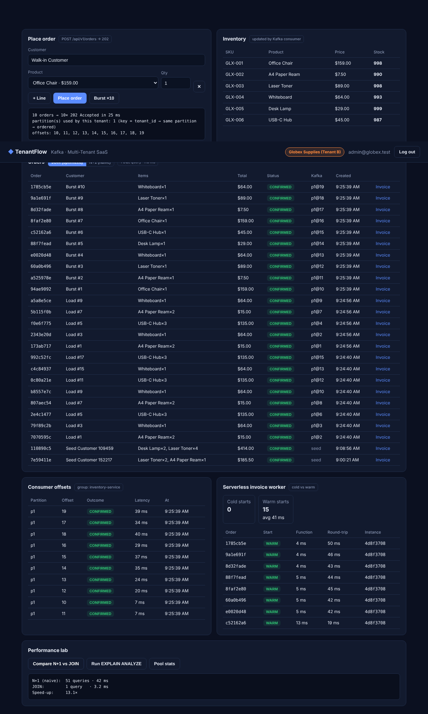
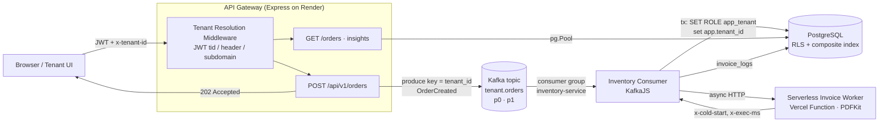

# TenantFlow: Multi-Tenant B2B SaaS with Kafka, Query Tuning and Serverless

A production-style **multi-tenant order platform**:

- **Orders are asynchronous.** The API answers `202 Accepted` and publishes an `OrderCreated` event to the **Kafka** topic `tenant.orders`. A **KafkaJS consumer group** then updates inventory.
- **Tenant isolation has two layers.** Every query is scoped by `tenant_id` in the app, and **PostgreSQL Row-Level Security** blocks cross-tenant rows in the database itself.
- **Database tuning** covers N+1 elimination, `EXPLAIN ANALYZE` before and after a composite index, and `pg.Pool` connection pooling.
- **A serverless invoice worker** on Vercel generates PDFs and records whether each call was a **cold start** or a **warm start**.

| | |
|---|---|
| **Live app** | `https://<your-app>.onrender.com` |
| **Invoice function** | `https://<your-fn>.vercel.app/api/invoice` |
| **Kafka** | Aiven for Apache Kafka (free tier) |
| **Database** | Neon PostgreSQL (pooled endpoint) |

> Upstash Kafka was discontinued in March 2025, so this project uses **Aiven's free Kafka tier**. That tier allows 5 topics with 2 partitions each, which is why `KAFKA_PARTITIONS=2`.



---

## 1. Architecture



**Request flow**

1. `POST /api/v1/orders`: the payload is validated and an event is built. `tenantId` **always comes from the JWT**, never from the body.
2. The producer is idempotent (`acks=-1`). It sends the event with **message key = `tenant_id`**. Kafka hashes the key with murmur2, so every event of one tenant lands on the same partition. That gives **strict per-tenant ordering**.
3. The API returns `202 Accepted` with `{orderId, kafka:{partition, offset}}` in about 10 ms.
4. The `inventory-service` consumer group reads the event. In one tenant-scoped transaction it:
   - checks idempotency in `processed_events`
   - locks the product rows (`SELECT … FOR UPDATE`)
   - decrements stock
   - inserts the order and its items
   - records the partition and offset
5. If the order is confirmed, the consumer calls the **Vercel function** to generate a PDF invoice. It logs the round-trip time and whether the call was a cold start (`invoice_logs`).

---

## 2. Multi-Tenancy and Tenant Isolation

**Strategy: shared database with a `tenant_id` discriminator.** Every tenant-owned table has a `tenant_id` column.

### How the tenant is resolved (`src/middleware/tenant.js`)

| Route type | Where the tenant comes from |
|---|---|
| Login (public) | `x-tenant-id` header (slug or UUID), or subdomain `acme.<ROOT_DOMAIN>`, or `body.tenant` |
| All other routes | **JWT claim `tid`**. If a header or subdomain is also sent and disagrees with the token, the request gets **403 `TENANT_MISMATCH`** |

### Data boundary (two layers)

1. **App layer.** Every SQL statement contains `WHERE tenant_id = $1`. The value comes from `req.tenant.id`, which is taken from the JWT.
2. **Database layer (RLS).** `withTenant()` in `src/db/tenantDb.js` wraps each request in a transaction like this:

   ```sql
   BEGIN;
   SET LOCAL ROLE app_tenant;                       -- non-owner role → RLS enforced
   SELECT set_config('app.tenant_id', '<uuid>', true);
   -- queries…
   COMMIT;
   ```

   This policy is applied to every table:

   ```sql
   CREATE POLICY tenant_isolation ON orders
     USING      (tenant_id = current_setting('app.tenant_id')::uuid)
     WITH CHECK (tenant_id = current_setting('app.tenant_id')::uuid);
   ```

   So even a buggy query with no `WHERE` clause **cannot** return or insert another tenant's rows.

### Isolation test suite (`npm run test:isolation -- --with-kafka`)

| Check | Result |
|---|---|
| Tenant A credentials on Tenant B login → 401 | ✅ |
| Tenant A order list contains 0 Tenant B orders (JOIN and N+1 paths) | ✅ |
| Tenant A `GET /orders/<B's id>` → 404 | ✅ |
| Tenant A token + `x-tenant-id: globex` → 403 | ✅ |
| Forged JWT (`tid` = B, wrong secret) → 401 | ✅ |
| RLS: A's context `WHERE tenant_id = B` → 0 rows | ✅ |
| RLS: A's context, unfiltered `SELECT` → sees 1 tenant only | ✅ |
| RLS: A's context `INSERT` with B's tenant_id → blocked | ✅ |
| A posts B's productId plus `body.tenantId = B` → event keyed to A, consumer **REJECTS** it, B's stock untouched | ✅ |

**Result: all 15 checks pass, 0 violations.**

---

## 3. Benchmarking

> These numbers were captured with PostgreSQL 16 and 200,000 orders. Re-run the scripts on your deployment and they will regenerate the files in `docs/benchmarks/`.

### 3.1 EXPLAIN ANALYZE: before vs after the composite index

```sql
CREATE INDEX idx_orders_tenant_created ON orders (tenant_id, created_at DESC);
```

| Query | Before (ms) | After (ms) | Speed-up |
|---|---:|---:|---:|
| Q1: latest 50 orders of a tenant | 31.564 | 0.063 | **501×** |
| Q2: tenant orders in last 7 days | 19.946 | 2.505 | **8×** |

<details><summary><b>Before</b>: Parallel Seq Scan + top-N Sort (shared hit = 6224 buffers)</summary>

```
Limit  (actual time=27.996..32.606 rows=50 loops=1)
  Buffers: shared hit=6224
  ->  Gather Merge  (actual time=27.993..32.597 rows=50 loops=1)
        Workers Launched: 2
        ->  Sort  (actual time=23.743..23.751 rows=44 loops=3)
              Sort Key: created_at DESC
              Sort Method: top-N heapsort  Memory: 36kB
              ->  Parallel Seq Scan on orders
                    Filter: (tenant_id = '…'::uuid)
                    Rows Removed by Filter: ~33,000 per worker
Execution Time: 32.636 ms
```
</details>

<details><summary><b>After</b>: Index Scan, no sort (shared hit = 53 buffers)</summary>

```
Limit  (actual time=0.011..0.037 rows=50 loops=1)
  Buffers: shared hit=53
  ->  Index Scan using idx_orders_tenant_created on orders  (actual time=0.010..0.033 rows=50 loops=1)
        Index Cond: (tenant_id = '…'::uuid)
Execution Time: 0.046 ms
```
</details>

**Why it is faster:** the index is ordered by `(tenant_id, created_at DESC)`. Postgres jumps straight to the tenant's newest rows and stops after 50, so there is no full scan and no sort. Buffer reads drop by about 117×.

📸 Screenshots: `docs/screenshots/explain-before.png`, `docs/screenshots/explain-after.png`

### 3.2 N+1 query problem (`npm run bench:n1`)

| Strategy | SQL queries | Median latency (ms) |
|---|---:|---:|
| Naive loop (1 query for orders + 1 per order) | 51 | 14.78 |
| Single `LEFT JOIN` + `json_agg` (eager load) | 1 | 1.98 |

The JOIN is **7.4× faster** on localhost. Over a cloud DB with about 20 ms per round-trip, the naive version costs roughly 1 second while the JOIN stays around 25 ms. Both versions are in `src/services/orderQueries.js`. You can also compare them live: `GET /api/v1/orders?mode=naive` vs `?mode=optimized` returns the `x-query-count` and `x-query-ms` headers.

### 3.3 Connection pooling (`npm run bench:pool`)

| Mode | Total (ms) | p50 (ms) | p95 (ms) |
|---|---:|---:|---:|
| New connection per query | 570 | 27 | 43 |
| `pg.Pool` (max=10) | 33 | 1 | 12 |

Pool config is in `src/db/pool.js`: `max`, `idleTimeoutMillis` and `connectionTimeoutMillis`. In production the app also connects to Neon's **pooled (PgBouncer) endpoint**. Live stats: `GET /api/v1/insights/pool`.

### 3.4 Serverless cold start vs warm start (`npm run bench:coldstart`)

Detection works because a function's module scope runs **once per container instance**. The first invocation on a new instance reports `x-cold-start: true` and `x-init-ms`, which is the time to load PDFKit.

| Start type | Median round-trip (ms) | Handler (ms) | Module init (ms) |
|---|---:|---:|---:|
| Cold start | _fill from Vercel run_ | _…_ | _…_ |
| Warm start | _…_ | _…_ | 0 |

Local reference (`npm run fn:dev`): cold = 131 ms init + 68 ms handler; warm = 3–5 ms handler.

**To capture a real cold start:** redeploy the function, or leave it idle for about 15 minutes, then run the bench. The first call is cold and the next 10 are warm. On Vercel, also check *Logs*: the JSON log line includes `coldStart` and `initMs`.

**Why cold starts happen:** a new micro-VM boots, the Node runtime starts, `require()` loads the dependencies, and only then does the handler run. Ways to reduce it: keep dependencies small, keep the function warm (cron ping), raise memory (more CPU), or use Vercel Fluid compute, which reuses instances.

---

## 4. Test Accounts

| Tenant | Slug (`x-tenant-id`) | Email | Password |
|---|---|---|---|
| **Tenant A**: Acme Traders | `acme` | `admin@acme.test` | `TenantA@123` |
| **Tenant B**: Globex Supplies | `globex` | `admin@globex.test` | `TenantB@123` |

---

## 5. API

| Method | Path | Notes |
|---|---|---|
| POST | `/api/v1/auth/login` | header `x-tenant-id`, body `{email,password}` → JWT |
| POST | `/api/v1/orders` | `{customerName, items:[{productId, quantity}]}` → **202** |
| GET | `/api/v1/orders?mode=naive\|optimized` | N+1 vs JOIN, returns query count |
| GET | `/api/v1/orders/:id` | 404 if it belongs to another tenant |
| GET | `/api/v1/orders/:id/invoice` | PDF from the serverless function |
| GET | `/api/v1/products` | Inventory (stock is updated by the consumer) |
| GET | `/api/v1/insights/events` | Processed Kafka offsets |
| GET | `/api/v1/insights/invoices` | Cold/warm stats |
| GET | `/api/v1/insights/explain` | Live EXPLAIN ANALYZE |
| GET | `/api/v1/insights/n1` | Live N+1 comparison |
| GET | `/api/v1/health` | DB and pool status |

```bash
curl -X POST $API/api/v1/auth/login -H "x-tenant-id: acme" -H "content-type: application/json" \
  -d '{"email":"admin@acme.test","password":"TenantA@123"}'
```

---

## 6. Run Locally

```bash
docker compose up -d          # Postgres 16 + Redpanda (Kafka API) + Console on :8080
cp .env.example .env
npm install
npm run db:setup              # schema + RLS + 2 tenants + 100k orders
npm run kafka:topic           # tenant.orders, 2 partitions
npm run fn:dev                # terminal 1: invoice function on :3001
npm run consumer              # terminal 2: Kafka consumer (offset logs)
npm run dev                   # terminal 3: API + UI on http://localhost:4000
```

## 7. Deploy

1. **Neon** (DB): create a project and copy the *pooled* connection string. Then, from your machine, run:
   ```bash
   DATABASE_URL=... DB_SSL=true npm run db:setup
   ```
2. **Aiven Kafka** (free): create the service, then:
   - Enable **SASL** under *Advanced configuration → kafka_authentication_methods.sasl*.
   - Create the topic `tenant.orders` with 2 partitions.
   - Download `ca.pem` and set `KAFKA_CA_CERT` to its base64.
3. **Vercel** (function): import the repo, set **Root Directory = `serverless`**, and add the env var `INVOICE_SECRET`.
4. **Render** (API + UI + consumer): create a New Blueprint from `render.yaml`. Fill in `DATABASE_URL`, the Kafka variables, `INVOICE_FUNCTION_URL` and `INVOICE_SECRET`. On the free plan, `RUN_CONSUMER_IN_API=true` runs the consumer inside the web service. To run it separately, use a Background Worker with `npm run consumer`.

## 8. Project Structure

```
src/
  server.js              Express app (API + static UI)
  consumer.js            standalone Kafka consumer
  config.js
  middleware/tenant.js   tenant resolution + JWT
  db/pool.js             pg.Pool (connection pooling)
  db/tenantDb.js         withTenant(): SET ROLE + app.tenant_id (RLS)
  db/schema.sql          tables + RLS policies
  kafka/                 client (SSL/SASL), producer, consumer
  routes/                auth, orders, insights
  services/              orderQueries (N+1 vs JOIN), invoiceClient
serverless/              Vercel function + Lambda handler + local dev server
scripts/                 migrate, seed, explain, n1/pool/coldstart benches,
                         isolation test, load generator, kafka admin
public/                  dashboard UI
docs/benchmarks/         generated benchmark outputs
```
